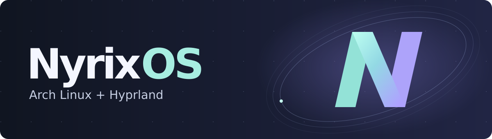

# 

NyrixOS is an Arch Linux-based distribution in early development with a preconfigured Hyprland desktop.

We plan to offer two ways to use NyrixOS:

- **Starting fresh?** Boot the [live ISO](iso/) from a USB drive, try the desktop, and install NyrixOS.
- **Already running Arch Linux?** Use the [install script](install/) to set up the same desktop on your existing system.

Neither the ISO nor the install script is available yet.
