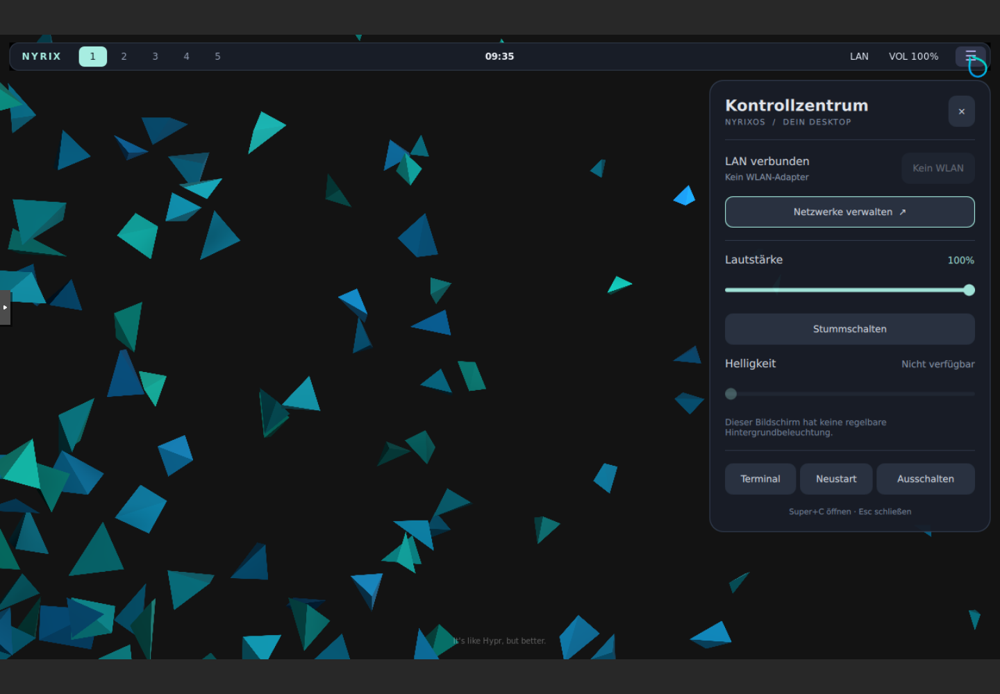

# NyrixOS desktop: Waybar + Quickshell

For the current feature summary see [the project README](../README.md) and
[unreleased changelog](../CHANGELOG.md). Dated sections below are an incremental
implementation/test history, not a claim that every historical UI still exists.

The first desktop layer on the plain Arch + Hyprland base. No app suite, launcher,
notification daemon or graphical login manager is added.

- Floating Waybar with separate borderless dark-grey pills at the top: workspaces, active window, clock, tray, network,
  volume and battery (only when present).
- Top-right compact Quickshell control center: Wi-Fi and Bluetooth switches,
  backlight and PipeWire volume sliders, and one Settings button. No terminal,
  power actions or extra connection buttons on the main panel.
- Settings opens a normal floating window with a local profile header and a
  sidebar for Network & Bluetooth, Display, Personalization, Shortcuts and Updates. It reuses the status-menu
  controls, keeping connections, volume and hardware states consistent.
- Neutral dark-grey bar pills without outlines; original distro SVG replaces the wordmark. The control center and status popups share neutral dark-grey surfaces, subtly lighter close buttons and compact pill switches. Mint is reserved for active controls. The owner-supplied landscape is the default wallpaper, displayed by Quickshell
  on every output with aspect-preserving crop; no extra wallpaper daemon is needed.

## Use

Click **Wi-Fi, Bluetooth or volume** for its own compact menu below the status pill.
The **chevron / Super+C / Ctrl+Alt+C** still opens the full control center.
Escape or × closes the panel. The **distro icon** opens a terminal. Right-click the volume
icon to mute; scrolling changes volume. Super+Enter remains the terminal shortcut.

`nyrix-desktop` starts both components once per user session, using a runtime lock.
`nyrix-controls` toggles the panel via Quickshell IPC. Logs live in
`~/.local/state/nyrix/`. The supplied Hyprland config starts it automatically.

## Installation and layout

- `system/packages.x86_64`: plain system base.
- `desktop/packages.x86_64`: the shell/audio/backlight additions.
- `desktop/config/`: Waybar and Quickshell configuration.
- `desktop/bin/`: session launchers.

`install/install.sh --user USER` installs both package lists and copies new config
without overwriting an existing user's configuration. Existing Hyprland users
must merge the `nyrix-desktop` startup command and `nyrix-controls` keybinding
from `system/config/hyprland.lua` themselves. The script never partitions disks.

The ISO profile generator consumes the same manifests/config. Previously built
minimal ISOs are unchanged: build a NEW image to include this desktop.

## Verified in the development VM

- Waybar 0.16.0 and Quickshell 0.3.2 load; Hyprland reports no config errors.
- Public noVNC renders the shell; clicking the bar opens the panel.
- Browser slider changes PipeWire volume (1.00 -> 0.47), mute changes server state;
  test restored volume and unmuted afterwards. Audible remote playback not tested.
- Escape closes the panel. Restart opens a confirmation without restarting.
- Missing Wi-Fi/backlight/battery is handled explicitly (disabled/absent), not fake.
- Network configuration uses the real `nmtui`, not a custom connection editor.

Physical Wi-Fi, backlight, battery and audio hardware still need real-device tests.
No disk-installer or new ISO boot validation is implied by these UI checks.

The bar icon is an exact copy of `assets/nyrix-logo.svg`, stored beside the CSS
so both the installer and generated ISO can resolve its relative image path.

Network, audio, optional battery and the control-center chevron now share one
borderless status pill. Only icons are visible; details are tooltips. Ethernet
and Wi-Fi use distinct icons, mute and charging update with service state.
Icons are Lucide SVGs with the upstream license in `config/waybar/icons/LICENSE`;
no icon-font dependency is needed.

Wi-Fi and Bluetooth icons are always visible, even without an adapter. A muted,
slashed icon indicates off/unavailable; the tooltip distinguishes those states.
`nyrix-radio-status` reads NetworkManager / BlueZ state every five seconds without
powering hardware on. The desktop package set includes BlueZ and enables its service for hardware-equipped
systems. VM absence is tested; physical radio switching is not. The existing LAN
status is still shown separately.

## Separate status menus

- Wi-Fi: hardware-aware switch, live NetworkManager scan, network list, connection/
  disconnection, password input for personal WPA networks. Enterprise/hidden setup
  remains available through `nmtui`. Passwords go directly to NetworkManager via
  Quickshell, never through command arguments or logs; input is cleared on close.
- Bluetooth: hardware-aware switch and scanned/known devices. Paired devices can
  connect/disconnect directly. First-time pairing uses an interactive `bluetoothctl`
  terminal agent so PIN/confirmation requests are not silently accepted. This is
  a temporary fallback, not a finished graphical pairing wizard.
- Volume: real PipeWire slider plus mute. LAN opens a small connection summary.
- One status menu at a time; a second icon click or Escape closes it. Opening the
  full control center closes the small menu and vice versa. Scanning only runs
  while the matching menu is visible. Long/untrusted names render as plain text.

Native interfaces: [Quickshell Networking](https://quickshell.org/docs/v0.3.0/types/Quickshell.Networking/)
and [Bluetooth](https://quickshell.org/docs/v0.3.0/types/Quickshell.Bluetooth/).

VM has neither radio: real wireless discovery, password authentication and Bluetooth
pairing still require hardware verification. No rebuilt ISO is implied by deployment.

### Status-menu verification — 2026-11-18

Verified through the external noVNC browser: individual icon clicks open the
small panel, not the control center; switching icons replaces the menu; clicking
again and Escape close it. Wi-Fi and Bluetooth display their missing-adapter
states with disabled switches. Slider changed real PipeWire volume from 1.00 to
0.47; mute toggled; original volume/mute were restored. Quickshell loaded the new
component successfully. Physical-radio paths are implemented but not certified.

## Default wallpaper

`config/quickshell/nyrix/wallpaper.png` is the original image supplied by the owner
on 2026-11-18, copied without modification. `Wallpaper.qml` displays it behind
windows on every output. The config-copy paths include it in both script installation
and future ISO builds. Existing user files are preserved by the installer.
Provenance: owner-supplied attachment; no third-party license is asserted.

### Consistent controls — 2026-11-18

Borderless grey control center with grouped radio and level cards. Shared 46×26
pill switches use a sliding circular thumb, mint on state and dimmed unavailable
state; close buttons use a subtly lighter grey. External noVNC verified panel
rendering, separate radio/audio menus and close-button interaction. No new ISO
has been built; source and installed development VM were updated.

## Cursor

Breeze Light, white at 24 px, from the official Arch breeze-cursors package.
The session exports XCURSOR defaults, Hyprland applies the compositor cursor on
startup and GTK 3/4 receive matching settings. Existing user config remains
preserved by the installer. Enabled in the running VM; no new ISO build.

### Compact control center — 2026-11-18

Owner-requested layout: title, two radio switches, brightness and volume, Settings.
Deployed to the installed VM; Quickshell hot reload succeeded and VM framebuffer
rendering checked. Browser session requires login again, so no fresh browser
click-test is claimed. No adapter/backlight means disabled controls. ISO not rebuilt.

## Fish terminal and Fastfetch — 2026-11-18

Foot opens Fish by default (`shell=/usr/bin/fish`), with a dark-grey palette,
mint command highlighting and a compact two-line prompt with Git information.
The account login shell remains unchanged, preserving existing TTY/session startup.

Interactive Fish greets with Fastfetch: mint/lavender text N logo, NyrixOS heading
and real OS/kernel/desktop/shell/terminal, CPU, RAM, root filesystem and uptime.
No network addresses, hostname or username are included. Arch remains honestly
identified as the underlying OS. No external prompt plugin or icon font is needed.

Files in `config/foot`, `config/fish` and `config/fastfetch` are picked up by
both setup and ISO profile generation. Existing user configs remain preserved:
if Foot already has a config, merge `shell=/usr/bin/fish` yourself. Fish/fastfetch
are in the desktop package manifest. Run `fastfetch` to show the summary again.

Verified on the installed VM: Fish syntax check, Foot config validation,
Fastfetch execution and actual rendered Foot + Fish greeting via VM framebuffer.
Non-interactive Fish prints only command output, with no greeting. The desktop
login shell and autostart were not changed; no ISO rebuilt or Git push performed.

Fastfetch format reference: https://github.com/fastfetch-cli/fastfetch/wiki/Configuration

## Unified workspace pill and terminal surface — 2026-11-18

Workspaces and the focused-window title now share one Waybar group/capsule.
Only workspaces 1–3 are persistent; additional workspaces appear when used.
Existing shortcuts for workspaces 4–5 remain available. Empty-window padding
collapses without adding a second pill.

Foot background alpha is 0.94 (text remains opaque). A class-scoped Hyprland
rule gives Foot 16 px rounded corners without changing other applications.
New terminals pick up the alpha setting; existing shells need not be closed.

Verified: Foot config validation, no Hyprland config errors, Waybar reload,
and VM framebuffer shows three workspace buttons plus title in one pill and
a rounded, subtly transparent terminal. Shared repo defaults updated;
no ISO rebuild or Git publication.

## Settings window — 2026-11-18

The Settings button closes the control-center popup and opens one reusable
Quickshell FloatingWindow, titled `NyrixOS Einstellungen`. Left: local user
display name (passwd GECOS, falling back to username), ~/.face image or neutral
avatar, and category navigation. Right: the selected settings content.
No owner name/photo is embedded in the public defaults.

Categories: Wi-Fi, Bluetooth, Audio and Display (currently brightness).
Radio/audio controls are shared with the compact bar menus via StatusContent.qml.
Radio discovery has one owner shared by both views, active only while relevant
content is visible. Missing hardware remains disabled. Advanced network setup
and first-time Bluetooth pairing retain their documented terminal fallbacks.

A title-scoped Hyprland rule floats and rounds this normal desktop window;
dragging its header moves it. Close hides it for reopening, not the desktop shell.
VM input/framebuffer tests checked category switching and a real audio-volume
change (100% to 49%, restored). Hardware radio/backlight operations remain untested
on this VM. This is not a full account editor or a full display-mode manager.
No new ISO built or Git publication.

## Bilingual settings and updates — 2026-11-18

Settings categories now are Network & Bluetooth, Display, Personalization, Updates.
Personalization selects German or English. Quickshell text switches immediately;
the user locale is saved in `~/.config/nyrix/locale` and environment.d for subsequent
sessions/applications. Both locales are generated during installation. Keyboard
layout remains unchanged. Waybar's generated runtime config and radio tooltips
follow the selected language. Upstream application translations depend on their
own language support; Git commit messages are displayed in their original language.

Update check reads GitHub main and commit messages without root or changing packages.
Update now opens Foot for sudo and explicit confirmation. The root-owned updater
clones the fixed upstream main into a fresh root-owned staging directory, checks
for an installable payload, then invokes the shared installer with a full
`pacman -Syu`. It never executes a user-writable checkout as root. A lock prevents
two NyrixOS updates concurrently; pacman's own lock remains respected.

Explicit update mode backs up ~/.config and /usr/local/bin into root-only
`/var/lib/nyrixos/backups/` before replacing supplied defaults. Personal files not
in the payload remain unchanged. This is NOT an atomic/rollback-capable OS update;
package updates already applied remain if a later step fails. Do not interrupt
pacman. Log: `/var/lib/nyrixos/update.log`; installed revision is recorded only
once the complete installer succeeds. Sign in again after updating; reboot for a
new kernel. No unattended scheduler or passwordless update permission is added.

Current publication blocker: GitHub main does not yet contain this installer.
Both check and updater detect this; updater stops before modifying the system.
VM verification: QML loaded; both language layouts inspected via VM framebuffer;
radio tooltips switch; unpublished payload rejected. Successful remote release
installation remains unverified until publication. No ISO rebuild or Git push.

## Editable shortcut cheat sheet — 2026-11-18

Settings → Shortcuts lists 18 shipped bindings in German or English. Each row
supports editing its chord, saving (also Enter), and restoring that row's default.
Supported keyboard chords contain Super/Ctrl/Alt/Shift plus a letter, digit,
F1–F24 or a supported navigation key. Mouse drag/resize rows accept mouse:272,
mouse:273 or mouse:274. Existing actions remain fixed; this is not an arbitrary
command editor or an editor for independently added Hyprland bindings.

`nyrix-shortcuts` rejects malformed/duplicate combinations, stores overrides in
`~/.config/nyrix/shortcuts.json`, and generates `shortcuts.lua` alongside it.
Hyprland loads that file, falling back to shipped `shortcuts-default.lua`.
User overrides are not shipped defaults and are not overwritten by updates.
Writes are locked/atomic with previous-file backups. A failed compositor reload
restores both prior files and reloads them. No sudo or session restart is needed.

Verified in VM: rendered cheat sheet, keyboard edit + Save in the actual window,
live compositor binding changed to Super+T, Default button restored Super+Return,
duplicate and code-like input rejection, no compositor config errors. Unit test
also exercises rollback on a failed reload. No ISO rebuild or publication.

### Minimal volume popup — 2026-11-18

Volume popup now contains only a speaker icon on the left and the slider, without
percentage text or a separate mute button. The icon is muted at zero or when the
PipeWire mute flag is set. Clicking toggles mute; at zero it restores the last
positive level (50% fallback). Moving the slider above zero unmutes. Shared Lucide
SVGs and license are bundled inside the Quickshell config so reload resolves them.
VM framebuffer/input tested: click mute/unmute changes real PipeWire state, slider
zero shows the muted icon; initial volume/mute restored afterwards.

The control center now uses the same icon-only volume row as the popup (including
quick mute and zero-volume icon state). Brightness has a matching left-aligned
sun icon and slider; percentage/row headings removed. Missing VM backlight stays
dimmed and disabled with an unavailable tooltip. VM rendering and control-center
mute click checked against PipeWire; original unmuted state restored.

## Settings visual redesign — 2026-11-18

Larger 940×650 default window (minimum 780×520), compact horizontal profile with
initial fallback, icon navigation, charcoal surfaces and restrained mint selection.
Each network section is a separate padded card. Shortcuts use individual cards and
consistent 38 px fields/buttons; updates separate actions from readable changelog.
Personalization includes a static current-default wallpaper preview (not an editor).
Shared SettingsCard/SettingsButton components are scoped to the settings app and do
not restyle the bar/status popups. Existing backends and permission flows unchanged.

VM framebuffer and pointer verification: all five categories, German/English
switch through the actual language buttons, shortcut fields, update status and
missing-backlight display. Restored German and left Network & Bluetooth open.
No ISO rebuilt, no Git publication.

### Waybar compositor-context repair — 2026-11-18

A manual bar restart omitted HYPRLAND_INSTANCE_SIGNATURE, silently disabling both
Hyprland modules. nyrix-waybar now resolves the single instance matching the active
WAYLAND_DISPLAY via `hyprctl instances -j` before exec; ambiguous/missing sessions
fail visibly instead of starting an incomplete bar. Normal session startup remains
unchanged. VM restart verified IPC initialization and the restored 1/2/3 workspace
pill with the current window title. During UI checks inspect the whole bar, not only
the settings surface, to catch regressions outside the edited component.

## Dynamic Island — 2026-11-18

The middle clock is now one persistent Quickshell layer surface, not a Waybar
clock plus a separate popup. Click the clock to expand/collapse; Escape collapses.
Width (86→500) and height (36→430/470, capped by output) animate together over
300 ms with InOutCubic easing. Content fades while clipped inside the same pill.
No map/unmap compositor fade on ordinary opening/closing. Tabs form a single
28 px segmented capsule, centered at the top, with straight vertical separators.
Other status menus/control center collapse the island. Waybar center is intentionally
empty; its workspaces/window/title modules remain unchanged.

- Dashboard: local month calendar, previous/next/Today navigation and uptime.
  Calendar accounts/events are not connected; this is not a synced agenda.
- Performance: /proc CPU interval, memory and root filesystem usage. CPU sensor
  names are filtered; AMD sysfs GPU utilization and NVIDIA nvidia-smi are supported
  when available. Missing/virtual sensors show —, not fabricated readings. Sampling
  runs every 2.5 seconds only while the Performance tab is open.
- Weather: Open-Meteo geocoding, explicit city selection, current modeled conditions
  and five-day forecast. Cache for 15 minutes, offline cache marked stale. Changing
  location never reuses another city's weather. Location stays in the user's
  ~/.config/nyrix/weather-location.json; no personal city enters public defaults.
- AI: independent five-hour/seven-day consumed percentages and reset timestamps.
  No connected accounts on the development VM. These remain missing, never 0%.
  Claude consumes the official status-line rate_limits fields via
  `nyrix-island-data claude-import` on stdin. It saves only whitelisted numeric
  usage/reset fields and sampling time, not prompt/session/auth content. To connect,
  integrate that command into an existing Claude status-line script (pipe its
  incoming JSON to this helper, discard helper stdout, preserve existing output).
  No Claude settings are overwritten automatically. Codex, when installed and
  signed in as the desktop user, uses the official read-only app-server
  account/rateLimits/read RPC. It starts no model turn and reads no auth file.
  Only actual 300/10080-minute windows are mapped; ChatGPT/Codex quotas are not
  claimed to represent all ChatGPT models. Expired windows are hidden; old Claude
  observations are labeled stale. Missing installs/login remain disconnected.

Sources:
- https://open-meteo.com/en/docs and https://open-meteo.com/en/docs/geocoding-api
- https://code.claude.com/docs/en/statusline
- https://learn.chatgpt.com/docs/app-server

Verification: actual middle-pill click and four tab switches, framebuffer rendering,
real VM metrics, UI city search/selection and live weather fetch. New compact motion
uses a persistent mapped surface; intermediate and expanded sizes visually observed.
Unit checks cover missing/expired quotas, private payload filtering, stale offline
weather and location isolation. Live authenticated AI quota reads remain unverified
until the user links accounts. ISO not rebuilt; no Git publication.
