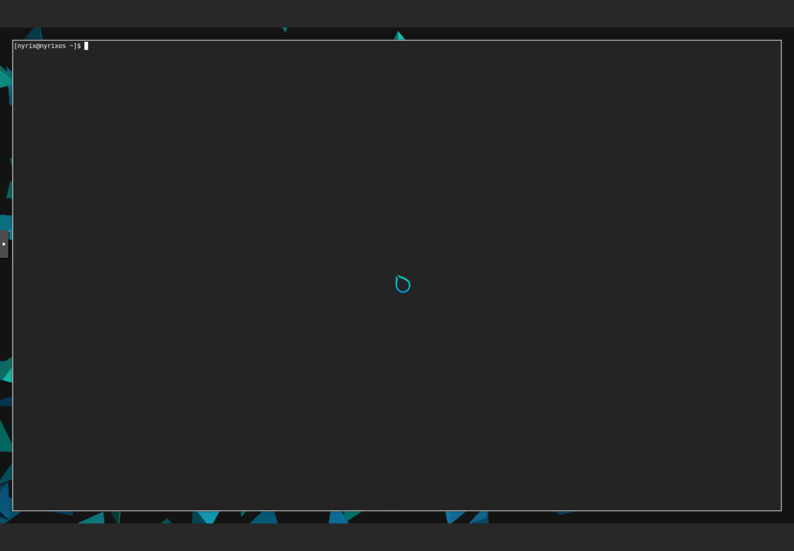

# Minimal baseline + disk installation — 2026-11-18

This supersedes the broader first live-desktop prototype.

## Minimal ISO

- Artifact: `nyrixos-0.1.20261118.0805-x86_64.iso`, about 1.2 GiB.
- SHA256: `60d5c093ba4c26770bc086872f552e0004333c9108eae2bb9106525c427f5cfd`.
- Archiso build completed; checksum matched on the VM host.
- UEFI live boot reached Hyprland + Foot with no failed system units.
- Firefox, Thunar, Waybar, Fuzzel, Mako and greetd were absent.

## Installed system

A new blank 24-GiB virtual disk was installed using Arch's `pacstrap` and the
repository's `system/packages.x86_64`, plus QEMU guest-agent support for testing.
The resulting system has a FAT EFI System Partition, ext4 root and systemd-boot.
The disk was cleanly unmounted before being reassigned to its target VM.

Verified:

- DVD drive empty and boot order set to the system disk.
- `/` mounted from an ext4 disk partition, not overlay; `/run/archiso` absent.
- Hyprland and Foot running, no Hyprland configuration errors or failed system units.
- Optional desktop applications and graphical login manager absent.
- English/German UTF-8 locales generated; German keyboard configured.
- Proxmox noVNC rendered the desktop; browser keyboard input created a file.
- After reboot, boot ID changed and both a browser-created file and a separate
  checksum-tested file persisted unchanged.
- HTTPS request to archlinux.org returned HTTP 200 over IPv4.
- Build VM stopped; installed development VM kept running.

The private development VM uses local automatic login and passwordless sudo.
Network login is not enabled. This is an explicit convenience for the test VM,
not a completed public installer policy. No graphical/public installer has been
implemented, and no stable ISO has been published.
