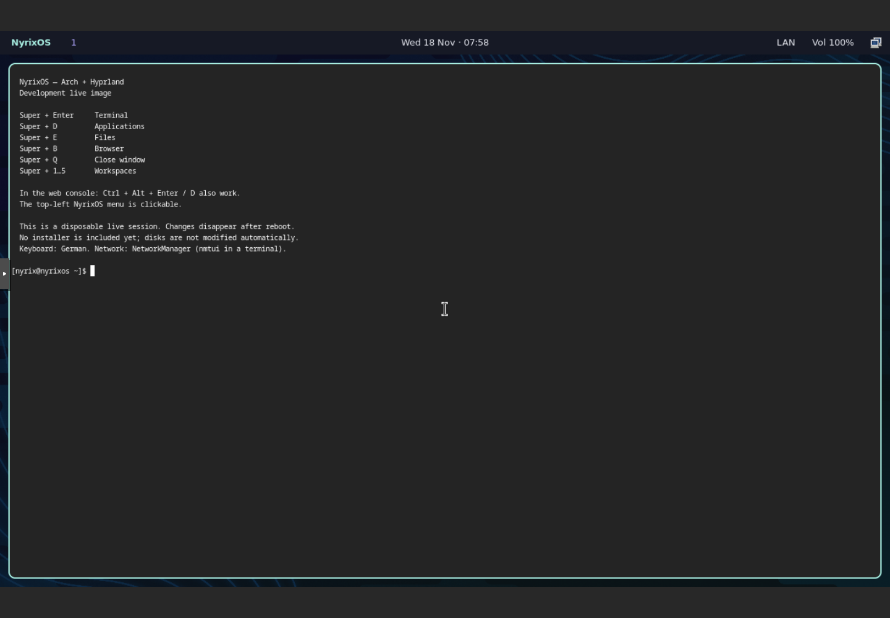

> Historical first prototype. Its optional desktop applications were removed by
> the owner's subsequent plain Arch + Hyprland requirement. See architecture.md
> for current scope and [minimal verification](minimal-verification.md) for the
> installed system; this page records the earlier, broader live image only.

# First live-image verification — 2026-11-18

Artifact: `nyrixos-0.1.20261118.0752-x86_64.iso` (about 1.6 GiB)

SHA256:

```text
011a84287c98872c2ab904ea8a2f72ca3a0dcce513e16effb7d21a340d45fd69
```

## Environment

Archiso 92, official Arch packages, Hyprland 0.57.2, Linux 7.3.4.
Tested on an x86_64 KVM/QEMU VM with OVMF UEFI (Secure Boot disabled),
2 vCPUs, 3 GiB RAM and virtio graphics using Mesa software rendering.
No system disk was attached. ISO checksum matched between builder and VM host.

## Passed

- ISO generation with `mkarchiso`; boot into the normal `nyrix` account.
- Hyprland Lua configuration reports no errors.
- greetd, NetworkManager and QEMU guest agent active; no failed system units.
- PipeWire, pipewire-pulse, WirePlumber and Hyprpolkitagent active; no failed user units.
  This checks services, not audible sound through the browser console.
- English and German UTF-8 locales generated.
- Waybar menu clicked through noVNC; Fuzzel visibly opens.
- Browser-console keyboard input opens a terminal and creates a marker file.
  Automation used plain text; punctuation depends on matching keyboard layouts.
- Firefox launched from the app menu and rendered its first-run page.
- HTTPS connectivity to archlinux.org returned HTTP 200 (IPv4 test).
- Guest reboot changed the boot ID, restored the desktop and discarded the
  marker, confirming ephemeral live state.
- Root account locked and SSH service masked.



## Limits

No installation, persistence, Secure Boot or physical-hardware certification yet.
Firmware warnings for several uncommon adapters remain in mkinitcpio's log;
the virtual test devices booted successfully. The initial download had an IPv6
connectivity issue in the build environment; IPv4 was used there, without
changing IPv6 support in the image. The browser-console test was performed on
the local network; it does not establish public internet accessibility.

The ISO is a locally built development artifact, not a published stable release.
